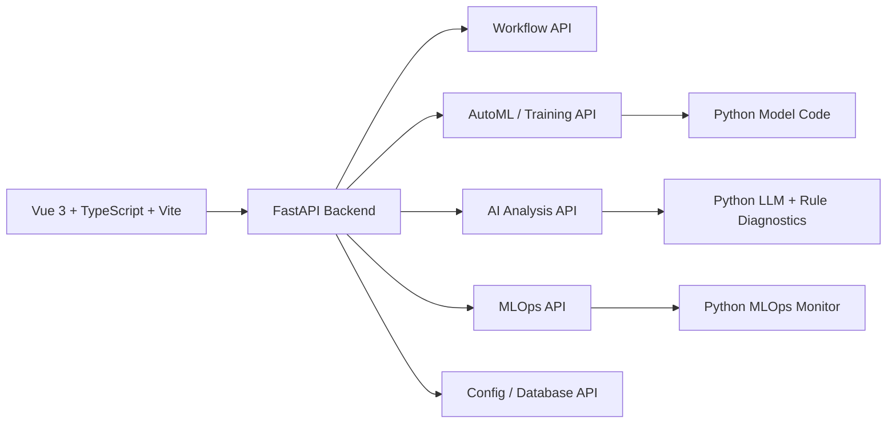

# TypeScript Frontend Migration Plan

日期：2026-06-03

## 结论

本项目推荐采用 **Vue 3 + TypeScript + Vite** 重写前端，后台继续保留 **Python + FastAPI**，模型训练、AutoML、LLM 分析和 MLOps 逻辑继续保留在现有 Python 模块中。

不建议当前阶段使用 Rust 重写后台。当前主要瓶颈不是底层服务性能，而是 Streamlit 前端在复杂工作流、状态管理、交互体验和模块化维护上的限制。TypeScript 前端迁移可以更快改善用户体验，并且不会破坏已有模型训练链路。

## 当前项目状态

当前项目主要由以下部分组成：

- `web_app/`：Streamlit 前端，包含手动训练、AutoML、AI 智能分析、MLOps 监控、数据库连接、大模型配置等页面。
- `backend/`：FastAPI 后端，已有 workflow、MLOps、AutoML SSE 等接口雏形。
- `model_code/`：传统模型训练、预测、AutoML、LLM 智能分析、MLOps 监控等核心逻辑。
- `core/`：Agentic workflow、AutoML optimizer、知识库、LLM schema 等能力。
- `frontend/`：目前只有 `src/components/OptunaDashboard.vue`，不是完整前端工程。

这说明项目已经具备前后端分离的基础，但完整产品前端仍然依赖 Streamlit。迁移重点应放在新建完整 Vue/TypeScript 工程，并逐步替换 Streamlit 页面。

## 目标架构



迁移后，前端只负责界面、交互、状态展示和 API 调用。训练、推理、分析、报告保存、模型 artifact 管理仍由 Python 后台完成。

## 技术选型

### 前端

- Vue 3
- TypeScript
- Vite
- Vue Router
- Pinia
- Element Plus
- ECharts
- Axios 或 Fetch wrapper
- OpenAPI TypeScript client generator

### 后端

- 继续使用 FastAPI
- 所有接口使用 Pydantic schema
- 暴露 OpenAPI
- SSE 用于训练进度、AutoML trial 进度和长任务日志
- 必要时补充任务状态查询、取消任务、报告下载接口

### 不做的事情

- 不用 Rust 重写后台
- 不重写 Python 模型训练核心
- 不一次性下线 Streamlit
- 不在前端直接处理模型训练逻辑
- 不在前端保存 API key 明文

## 前端目录结构建议

```text
frontend/
  package.json
  vite.config.ts
  tsconfig.json
  src/
    main.ts
    App.vue
    app/
      router.ts
      pinia.ts
      config.ts
    api/
      client.ts
      generated/
      automl.ts
      aiAnalysis.ts
      mlops.ts
      training.ts
      database.ts
      llmConfig.ts
      workflow.ts
    layouts/
      AppShell.vue
      SidebarNav.vue
      TopBar.vue
    modules/
      automl/
        views/
        components/
        stores/
        types.ts
      ai-analysis/
        views/
        components/
        stores/
        types.ts
      mlops/
      manual-training/
      llm-config/
      database/
      agent-workflow/
    shared/
      components/
      charts/
      composables/
      constants/
      types/
      utils/
```

目录原则：

- `modules/` 按业务模块拆分。
- `shared/` 只放跨模块复用组件和工具。
- `api/` 放接口封装，不在页面组件里直接拼 URL。
- `stores/` 只保存前端状态，不替代后台任务状态。
- `types.ts` 管模块局部类型，通用 API 类型优先由 OpenAPI 生成。

## 总体迁移策略

采用并行迁移，不一次性替换：

1. 新建 Vue/TypeScript 前端工程。
2. FastAPI 增加或整理必要接口。
3. Vue 前端先接入 AutoML 和 AI 智能分析。
4. Streamlit 和 Vue 并行运行。
5. 每完成一个模块，进入验收和灰度使用。
6. 所有核心模块稳定后，Streamlit 降级为内部调试入口。
7. 最终下线 Streamlit 页面，只保留必要的开发工具。

## 模块迁移顺序

### 1. AutoML 训练模块

对应旧页面：

- `web_app/pages/15_📊_AutoML 训练.py`
- `frontend/src/components/OptunaDashboard.vue`
- `backend/api/automl.py`
- `core/automl/automl_optimizer.py`

优先级：最高。

迁移理由：

- AutoML 有实时进度、trial 历史、参数表格、模型结果、图表，非常适合 Vue/TypeScript。
- 当前已有 Vue 组件雏形，可以最快落地。
- 能优先验证 FastAPI + SSE + Vue 的技术链路。

前端页面：

- AutoML 首页
- 数据源选择
- 目标列选择
- 模型候选选择
- 优化指标选择
- Trial 数和交叉验证配置
- 实时训练进度
- Trial 历史表格
- AUC/F1/PR-AUC 趋势图
- 最佳模型和最佳参数展示
- 保存模型结果
- 取消任务

后台需要补齐：

- `POST /api/automl/jobs` 创建 AutoML 任务
- `GET /api/automl/jobs/{job_id}` 查询任务状态
- `GET /api/automl/jobs/{job_id}/stream` SSE 推送进度
- `POST /api/automl/jobs/{job_id}/cancel` 取消任务
- `GET /api/automl/jobs/{job_id}/result` 获取最佳模型、最佳参数和指标
- `POST /api/automl/jobs/{job_id}/save` 保存模型 artifact

验收标准：

- 前端可以真实启动 AutoML 训练。
- 进度来自后台 SSE，不使用 mock 数据。
- 刷新页面后能恢复当前任务状态。
- 任务失败时展示错误原因和失败阶段。
- 最佳参数、最佳模型、指标曲线展示正确。
- 后端任务 ID 不允许路径穿越。

### 2. AI 智能分析模块

对应旧页面：

- `web_app/pages/13_AI_智能分析.py`
- `model_code/analysis/`
- `model_code/llm/intelligent_analyzer.py`

优先级：高。

迁移理由：

- 当前 AI 智能分析已经具备规则诊断、结构化结果、综合诊断报告和 registry。
- Vue 前端可以更好展示风险、证据、建议、报告历史和分析原文。

前端页面：

- 数据集分析
- 训练结果分析
- 超参数调优建议
- 预测结果分析
- 综合诊断
- 报告历史
- 报告详情

后台需要补齐：

- `POST /api/analysis/dataset`
- `POST /api/analysis/training`
- `POST /api/analysis/prediction`
- `POST /api/analysis/composite`
- `POST /api/analysis/reports`
- `GET /api/analysis/reports`
- `GET /api/analysis/reports/{analysis_id}`

接口返回建议：

```json
{
  "analysis_type": "training_analysis",
  "summary": "训练结果规则诊断风险等级为 medium。",
  "risk_level": "medium",
  "confidence": 0.9,
  "evidence": [],
  "risks": [],
  "recommendations": [],
  "next_actions": [],
  "metadata": {}
}
```

验收标准：

- 规则诊断结果和 LLM 分析结果可以合并展示。
- 风险等级、证据、建议、下一步动作结构化展示。
- 综合诊断报告可保存，并写入 registry。
- API key、token、password 等敏感字段不返回前端。
- 没有 LLM provider 时，规则诊断仍可使用。

### 3. MLOps 监控模块

对应旧页面：

- `web_app/pages/16_📈_MLOps 监控.py`
- `model_code/mlops_monitor.py`
- `backend/api/mlops.py`

优先级：高。

迁移理由：

- MLOps 需要图表、表格、筛选、刷新和状态展示，Vue 更合适。
- 之前出现过字段名不一致导致的 PSI 表格报错，前端类型约束和后端 schema 可以减少这类问题。

前端页面：

- 监控总览
- PSI 漂移表
- PSI 趋势图
- 特征漂移详情
- 基线管理
- 巡检日志
- 告警记录
- 重训触发记录

后台需要补齐：

- `GET /api/mlops/status`
- `GET /api/mlops/baseline`
- `POST /api/mlops/baseline`
- `GET /api/mlops/psi`
- `GET /api/mlops/inspections`
- `POST /api/mlops/inspect`
- `POST /api/mlops/retrain`

验收标准：

- PSI 表格字段由后端 schema 固定，不依赖前端猜字段名。
- 漂移等级颜色和阈值一致。
- 无基线时页面显示可操作空状态。
- 巡检任务可手动触发。
- 重训触发必须二次确认。

### 4. 手动训练模块

对应旧页面：

- `web_app/pages/4_📚_手动训练.py`
- `web_app/manual_training/`
- `model_code/model_trainer.py`
- `model_code/model_factory.py`

优先级：中高。

迁移理由：

- 手动训练模块最大，包含多个步骤，直接迁移风险较高。
- 应在 AutoML 和 AI 分析验证成功后迁移。

前端页面：

- 数据上传
- 字段配置
- 数据预览
- EDA
- 特征处理
- 模型选择
- 参数配置
- 训练执行
- 阈值分析
- 预测测试
- 模型保存

后台需要补齐：

- `POST /api/training/datasets`
- `GET /api/training/datasets/{dataset_id}`
- `POST /api/training/field-config`
- `POST /api/training/eda`
- `POST /api/training/jobs`
- `GET /api/training/jobs/{job_id}`
- `GET /api/training/jobs/{job_id}/stream`
- `GET /api/training/jobs/{job_id}/result`
- `POST /api/training/jobs/{job_id}/save`

验收标准：

- 可以完成从上传数据到保存模型的完整手动训练流程。
- 字段配置刷新后不丢失。
- 训练任务中断后可以查询失败原因。
- 训练结果包含指标、阈值、混淆矩阵、特征重要性。
- 参数配置有类型约束和默认值。

### 5. 大模型配置管理

对应旧页面：

- `web_app/pages/12_大模型配置管理.py`
- `model_code/llm/llm_connector.py`
- `config/llm_providers.json`

优先级：中。

迁移理由：

- 配置类页面适合在核心训练和分析模块稳定后迁移。
- 重点是安全，不能把密钥明文返回给前端。

前端页面：

- Provider 列表
- 新增 Provider
- 编辑 Provider
- 连接测试
- 启用/停用
- 当前激活模型展示

后台需要补齐：

- `GET /api/llm/providers`
- `POST /api/llm/providers`
- `PATCH /api/llm/providers/{provider_id}`
- `DELETE /api/llm/providers/{provider_id}`
- `POST /api/llm/providers/{provider_id}/test`
- `POST /api/llm/providers/{provider_id}/activate`

安全要求：

- API key 不返回明文。
- 编辑时只允许覆盖密钥，不允许读取密钥。
- 配置写入前做 provider 类型和 base_url 校验。
- 日志不打印密钥。

### 6. 数据库连接管理

对应旧页面：

- `web_app/pages/11_数据库连接管理.py`
- `model_code/database/`
- `core/knowledge/`

优先级：中。

前端页面：

- 连接列表
- 新建连接
- 测试连接
- Schema 浏览
- 表字段详情
- SQL 预览
- 样本数据预览

后台需要补齐：

- `GET /api/database/connections`
- `POST /api/database/connections`
- `PATCH /api/database/connections/{connection_id}`
- `DELETE /api/database/connections/{connection_id}`
- `POST /api/database/connections/{connection_id}/test`
- `GET /api/database/connections/{connection_id}/schema`
- `POST /api/database/query-preview`

安全要求：

- 凭证加密保存。
- 查询预览必须限制行数。
- SQL 执行必须区分只读和写入。
- 错误信息不能泄露完整连接串。

### 7. Agent 工作流模块

对应旧页面：

- `web_app/pages/14_🤖_Agent工作流.py`
- `backend/api/workflow.py`
- `core/llm/agent_orchestrator.py`
- `core/feature_engineering/`

优先级：中低。

迁移理由：

- Agent 工作流串联数据提取、特征生成、训练和预测，依赖其他模块的 API 稳定。
- 应在 AutoML、手动训练、AI 分析基本完成后迁移。

前端页面：

- Workflow 总览
- Step 1 自然语言取数
- Step 2 特征策略生成
- Step 3 训练进度
- Step 4 在线预测
- 执行日志
- 任务结果

后台需要整理：

- 当前 `/api/workflow/*` 已有雏形。
- Demo 数据逻辑需要和真实数据源拆开。
- 任务状态、错误恢复、SSE 断线恢复需要统一。

验收标准：

- 每一步都有明确状态。
- 后一步不能在前一步失败时执行。
- 用户可以查看 LLM 生成理由和结构化策略。
- 训练进度可实时展示。
- 预测请求使用已保存模型和特征执行器。

## 横向基础能力

### 1. API Client 和类型生成

建议使用 OpenAPI 生成 TypeScript 类型和 client。

目标：

- 后端 Pydantic schema 是唯一接口契约。
- 前端不手写核心响应类型。
- 接口字段变化时前端构建能发现问题。

实施步骤：

1. 整理 FastAPI response_model。
2. 暴露稳定 `/openapi.json`。
3. 使用生成工具生成 `frontend/src/api/generated/`。
4. 前端业务 API wrapper 基于 generated client 封装。

### 2. 任务状态模型

所有长任务统一使用状态模型：

```text
PENDING -> RUNNING -> SUCCEEDED
                  -> FAILED
                  -> CANCELLED
```

任务字段建议：

- `job_id`
- `job_type`
- `status`
- `progress`
- `current_step`
- `message`
- `created_at`
- `updated_at`
- `started_at`
- `finished_at`
- `error`
- `result_ref`

### 3. SSE 事件模型

SSE 事件建议统一：

```json
{
  "event": "progress",
  "job_id": "job_xxx",
  "status": "RUNNING",
  "progress": 42,
  "step": "trial_12",
  "message": "Trial 12 completed",
  "payload": {}
}
```

事件类型：

- `progress`
- `metric`
- `log`
- `result`
- `error`
- `heartbeat`
- `done`

### 4. 错误处理

后端错误响应统一：

```json
{
  "code": "INVALID_TARGET_COLUMN",
  "message": "目标列不存在",
  "detail": {},
  "request_id": "req_xxx"
}
```

前端展示原则：

- 用户看到清晰中文错误。
- 技术细节放到“查看详情”。
- 安全敏感信息不展示。
- 可重试错误提供重试按钮。

### 5. 安全要求

- 所有文件路径必须在项目允许目录内。
- 上传文件限制大小和类型。
- API key 不返回前端。
- 数据库密码不返回前端。
- 报告 registry 写入前脱敏。
- 训练任务参数需要后端校验。
- 用户输入 SQL 或自然语言查询不能直接拼接执行。
- 模型 artifact 下载需要明确路径白名单。

### 6. 测试要求

前端：

- TypeScript `tsc --noEmit`
- Vitest 单元测试
- Vue Testing Library 组件测试
- Playwright 端到端测试
- API mock 测试

后端：

- FastAPI route 单元测试
- SSE 流测试
- 任务取消测试
- 路径安全测试
- 敏感字段脱敏测试

集成：

- AutoML 完整训练流程
- AI 综合诊断保存报告
- MLOps PSI 查询
- 手动训练保存模型

## 分阶段实施计划

### Phase 0：前端工程初始化

目标：

- 建立 Vue 3 + TypeScript + Vite 工程。
- 打通 FastAPI 静态托管或独立开发服务器。
- 建立统一布局和路由。

任务：

- 创建 `frontend/package.json`、`vite.config.ts`、`tsconfig.json`。
- 创建 `AppShell`、侧边栏、顶部栏。
- 配置 Vue Router。
- 配置 Pinia。
- 配置 Element Plus。
- 配置 ECharts。
- 配置 API base URL。
- 配置构建脚本。

验收：

- `npm run dev` 可启动。
- `npm run build` 通过。
- 首页可访问。
- 能调用 FastAPI `/health`。

### Phase 1：AutoML 训练

目标：

- 替换 AutoML 训练页面。
- 实现真实 SSE 训练进度。

任务：

- 整理 `backend/api/automl.py`。
- 在 `backend/main.py` 启用 AutoML router。
- 实现 AutoML 任务创建和状态查询。
- 扩展 `OptunaDashboard.vue` 为完整页面。
- 增加 trial 表格、指标图、最佳参数卡片。

验收：

- 可以启动真实 AutoML 任务。
- 进度、trial、最佳值实时更新。
- 任务完成后展示结果。
- 页面刷新后可恢复任务状态。

### Phase 2：AI 智能分析

目标：

- 替换 AI 智能分析页面。
- 前端展示结构化诊断结果和报告历史。

任务：

- 新增 FastAPI analysis router。
- 封装 `model_code/analysis` 规则诊断接口。
- 封装 LLM 智能分析接口。
- 实现综合诊断保存。
- 前端实现数据、训练、预测、综合诊断页面。

验收：

- 不依赖 Streamlit 即可运行 AI 分析。
- 报告可保存和查询。
- 无 LLM 时规则诊断仍可用。

### Phase 3：MLOps 监控

目标：

- 替换 MLOps 监控页面。

任务：

- 整理 PSI 响应 schema。
- 实现 PSI 表格和趋势图。
- 实现基线保存、巡检、重训触发。

验收：

- PSI 表格不会因字段名变化报错。
- 巡检日志可查询。
- 重训触发有确认流程。

### Phase 4：手动训练

目标：

- 替换手动训练全流程。

任务：

- 拆分训练 API。
- 实现前端训练向导。
- 实现字段配置、EDA、参数配置、训练结果、预测测试。

验收：

- 可以完成完整手动训练流程。
- 训练结果和 Streamlit 旧流程一致或更完整。

### Phase 5：配置和数据库模块

目标：

- 替换 LLM 配置和数据库连接管理。

任务：

- 实现 provider 管理。
- 实现连接管理。
- 实现 schema 浏览和样本预览。

验收：

- 密钥不泄露。
- 数据库连接可测试。
- Schema 可浏览。

### Phase 6：Agent 工作流

目标：

- 替换 Agent 工作流页面。

任务：

- 整理 `/api/workflow/*`。
- 移除或隔离 demo 数据逻辑。
- 前端实现步骤式 workflow。

验收：

- 四步 workflow 可完整执行。
- 每步状态清晰。
- 失败可恢复或重试。

## 风险和控制

### 风险 1：迁移范围过大

控制：

- Streamlit 和 Vue 并行运行。
- 每个模块单独验收。
- 不在前两个阶段迁移所有页面。

### 风险 2：后端接口不稳定

控制：

- 先定义 Pydantic schema。
- 用 OpenAPI 生成前端类型。
- 接口变更必须同步类型生成。

### 风险 3：长任务状态丢失

控制：

- 任务状态写入后端存储。
- 前端刷新后通过 `job_id` 恢复。
- SSE 断线后可重新连接。

### 风险 4：敏感信息泄露

控制：

- API key、password、token 统一后端脱敏。
- 前端永远不展示密钥明文。
- 日志和 registry 写入前脱敏。

### 风险 5：前端类型退化

控制：

- 禁止大面积使用 `any`。
- API 类型由 OpenAPI 生成。
- `npm run typecheck` 必须通过。

## 里程碑

建议里程碑：

1. M0：Vue/TypeScript 工程初始化完成。
2. M1：AutoML 页面可替代 Streamlit。
3. M2：AI 智能分析页面可替代 Streamlit。
4. M3：MLOps 监控页面可替代 Streamlit。
5. M4：手动训练核心流程可替代 Streamlit。
6. M5：配置、数据库、Agent 工作流完成。
7. M6：Streamlit 降级为内部调试入口。

## 推荐下一步

下一步应从 **Phase 0：前端工程初始化** 开始。

第一批开发任务：

1. 创建完整 `frontend/` Vue 3 + TypeScript + Vite 工程。
2. 接入 Element Plus、Vue Router、Pinia、ECharts。
3. 建立 `AppShell`、侧边导航和基础主题。
4. 调通 FastAPI `/health`。
5. 增加 OpenAPI 类型生成脚本。
6. 将现有 `OptunaDashboard.vue` 纳入新工程。

完成 Phase 0 后，再进入 Phase 1 的 AutoML 真实接口和页面替换。
